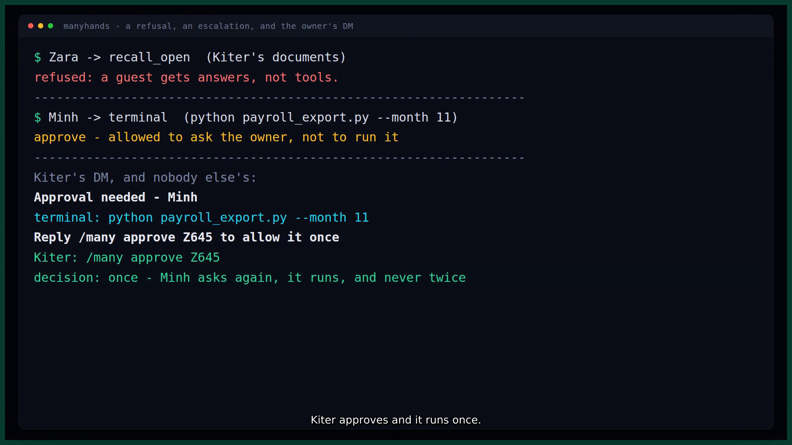

# manyhands

**One Hermes, many people.** Every sender who talks to your bot gets their own identity, their own
memory, their own tool allowlist and their own approvals — and you can see who asked for what.

```
Kiter  (owner)   → every tool
Minh   (member)  → web_search, recall_search, manyhands_remember …
Guest  (guest)   → web_search, manyhands_whoami
```

A Hermes gateway is a single-operator agent. The platform already carries per-sender identity into
every turn (`pre_llm_call` receives `sender_id` + `platform`), but nothing acts on it: everybody in
the group talks to the same memory, the same toolset and the same approval authority. manyhands is
the plugin that acts on it.

- **Identity** comes from the platform event, never from message text.
- **Roles** have three states per tool, not two: `allow` (runs), `ask` (the owner's DM decides) and
  (everything else) `never`. A member who asks for a shell command does not get "no" — they get the
  owner's phone lighting up. A guest never escalates: prompting the owner on a stranger's behalf is
  a phishing surface, not a feature. Roles are `owner`, `member`, `guest`, `blocked`.
- **Approvals** for anything sensitive are parked under a short code that goes to the **owner's DM**,
  not to whoever is in the room; the owner's `/many approve CODE` unlocks exactly one run.
- **Memory** is per person — and the operator's own `MEMORY.md`/`USER.md` is **withheld** from
  everybody else's system prompt, because "everyone gets their own Hermes" has to include not
  handing a stranger your notes.
- **Audit**: turns, tool calls, refusals, approvals and token usage, per person, in local SQLite.

Nothing leaves the machine. No network calls, no third-party dependencies, standard library only.

---



## Try it in two minutes (no install, no API key, no network)

```bash
git clone https://github.com/PhiBao/manyhands && cd manyhands
python3 tests/selftest.py        # 68 tests, ~15 s, standard library only
```

That is the whole core loop, checked without Hermes, a bot token or a model key: a stranger refused,
an invite redeemed once, a member's dangerous tool parked under the owner's code, that code unlocking
exactly one retry, an expired code refusing, the operator's memory withheld from a non-owner's prompt,
and a cold session failing closed. Every assertion names the behaviour it pins.

To see it run **inside the real host** (needs a Hermes checkout; no key is used because no model is
called):

```bash
~/.hermes/hermes-agent/venv/bin/python tests/live_integration.py   # drives the real PluginManager
hermes plugins validate ./                                        # the catalog CI gate
```

The plugin itself needs no model, no network and no third-party package — it is a policy and context
layer for the agent that already runs there. The AI it governs is the host's: it decides which tools
the model may call, what of the operator's own memory reaches the model's system prompt, and whose
turn each token bill belongs to.

---

## The gap it fills (measured, not assumed)

The public plugin catalog (`https://hermes-agent.nousresearch.com/docs/api/plugin-catalog.json`,
1,063 entries) has **zero** entries named `manyhands`, `household`, `rbac`, `tenant`, `roster`,
`invite` or `permission`. Nineteen entries use per-person language and every one of them is either
memory-layer storage scoping (`severian`, `mnemostack`, `agent_memory_es`, `holographic`, `dexio`,
`hicortex`, `tam`, `xmemo`) or dashboard login (`dashboard-auth-feishu`). **No plugin in the catalog
registers an approval transport or a memory provider keyed on the sender.**

Closest neighbours, and how this differs:

| Neighbour | What it does | Why manyhands is not it |
|---|---|---|
| `airlock` | taint tracking: once a session reads untrusted content, outbound actions need approval | different axis — content provenance, not human identity. It cannot tell your accountant from your intern. |
| `approval-ledger` | records approval prompts per rule/surface/day | metrics about approvals, not *who may do what*. |
| `hermes-teammates`, `bot-forge`, `advanced-delegation`, `omh` | rosters of **subagents/bots** | those are agents the operator owns. manyhands is a roster of **humans** the operator serves. |
| `identity` | edits SOUL/MEMORY/USER files, switches profiles | single operator, manual, no per-sender enforcement. |
| memory providers (`severian`, `hicortex`, …) | store memory per tenant/profile | storage scoping only: no roles, no tool permissions, no approvals, nothing audited. |

The claim this repo defends is narrow and true: **human-side multi-tenancy inside one live gateway
conversation does not exist in the marketplace.**

---

## What it registers

| Surface | Name | What it does |
|---|---|---|
| tool | `manyhands_whoami` | the caller's name, role, exact tool list, fact count |
| tool | `manyhands_people` | the roster, **read-only**: names, roles, tool counts. Roster changes are human-typed `/many` verbs |
| tool | `manyhands_remember` | write a fact into the **caller's own** namespace |
| tool | `manyhands_recall` | search the caller's facts + shared facts |
| tool | `manyhands_share` | publish a fact to everyone (owner/member) |
| tool | `manyhands_audit` | turns, tool calls, refusals, approvals, tokens — your own trail, the whole house only for the owner |
| hook | `pre_llm_call` | resolve identity, apply the unknown-sender policy, enforce the daily budget, inject the person card, record `turn_id → person_id` (and the session fallback) |
| hook | `pre_tool_call` | three-state allow/ask/never per role; escalate to approval; **fail closed** on unknown sessions |
| hook | `post_api_request` | attribute token usage to whoever owns the turn |
| middleware | `llm_request` | withhold the operator's own MEMORY/USER blocks from a non-owner's system prompt, and put the person card where it belongs (the system prompt) |
| transport | `manyhands` | dangerous-command prompts to the **owner's DM** under a short code (plugin escalations are parked and DM'd by the hook itself) |
| command | `/many` | `whoami · roster · audit [name] [hours] · invite [role] · claim [code] · add <platform> <sender_id> [role] · role <name> <role> · tools <name> [add\|remove] <tool…> · budget <name> <tokens> · remove <name> · pause · resume · approve [code] · deny <code>` — a bare `approve` lists the queue, and only to the owner |

Tested on **Hermes Agent v0.23.0** (`2bd378ed`), Linux.

## Install

```bash
hermes plugins install https://github.com/PhiBao/manyhands   # or: git clone … into your plugins dir
hermes plugins enable manyhands
```

Then, once:

1. **Claim ownership from the bot's own terminal.** `hermes chat`, then `/many claim`. It prints a
   one-time code. Send `/many claim <code>` from the chat account that should own the bot. Claiming
   requires local access to the machine — a stranger in the group cannot make themselves owner.
2. **Invite everybody else.** `/many invite member` mints a single-use code. They reply
   `join <code>` in the chat. Nobody self-registers silently.
3. **Let the plugin reach your DM** — one setting, because a notification needs the gateway:
   ```yaml
   plugins:
     entries:
       manyhands:
         allow_gateway_injection: true
   ```

That is all a role-gated tool needs. manyhands parks the ask itself: it mints a 4-character code,
sends *you* the prompt in your own DM, and **blocks the call** — nothing runs on silence. You answer
`/many approve CODE` in your own chat and the asker's next attempt runs exactly once.

### Why the plugin owns that hop

Hermes ships an approval-transport seam, and manyhands registers one (`transport: manyhands` is
still useful — see below), but the seam does not cover plugin escalations. In
`tools/approval.py` the gate a plugin escalation goes through is:

```python
_ACTION_GATE = _GateSpec(noun="action", transport=False, ...)
# "Plugin-escalated tool calls / protected writes: no transport…"
```

Only the dangerous-command and `execute_code` gates set `spec.transport=True`. So a
`pre_tool_call` escalation never reaches a registered transport, and a prompt left to the host's
built-in surface appears in whichever chat asked for the tool — the exact thing this plugin exists to
prevent. Verified against `hermes-agent` at the pinned commit, live, on a two-account bot.

**What the transport is still for:** dangerous shell commands. If a person *may* use `terminal` and
the command trips one of Hermes' own Tier-2 patterns, that gate does consult transports, so:

```yaml
security:
  approval:
    transport: manyhands
    transport_fallback: builtin   # keep the stock prompt for your OWN local/desktop sessions
```

**Set `transport_fallback: builtin` if you also work from the CLI or the desktop app**: a selected
transport replaces *every* approval surface, and with no gateway running there is nobody to DM, so
the honest answer is a deny — the fallback keeps your own approvals where they were.

## Settings

All of these live in `config.yaml` under `plugins.entries.manyhands.settings`, and every one has a
`config_schema` entry, so `hermes plugins config manyhands` validates them. Behaviour belongs in
`config.yaml`; `.env` is for secrets and this plugin has none.

| key | default | what it does |
|---|---|---|
| `unknown_sender_policy` | `invite` | `invite` refuses until a code is redeemed, `open` auto-guests, `closed` refuses outright |
| `invite_role` | `member` | the role a redeemed invite grants |
| `unknown_session_policy` | `guest` | a session with no human turn on it: `guest` fails closed, `operator` trusts every caller with no identity |
| `local_seat_policy` | `operator` | the operator's own terminal (`platform=cli` + this machine's attested `uid:<uid>`): `operator` is the host's own seat, `roster` makes it join like any other sender |
| `db_path` | *(empty)* | where the SQLite file lives; empty = the host's `plugin-data/manyhands/`. Set it here, not in `.env` |
| `approval_timeout_s` | `120` | how long the owner's DM waits before the ask is denied |
| `approval_tools` | *(unset)* | replace the per-role ASK bucket with one list; leave unset so guests never escalate |
| `max_person_facts` | `8` | how many of a person's own facts go into their turn |
| `max_shared_facts` | `5` | how many shared facts go into every turn |
| `scope_host_memory` | `true` | withhold the operator's `MEMORY`/`USER` blocks from non-owners (the `llm_request` middleware) |
| `paused` | `false` | the persisted default for `/many pause` |

`MANYHANDS_DB` is still read as an escape hatch by the stdlib test scripts and one-off migrations,
and a configured `db_path` always wins over it.

## Known host behaviour

**A tool called from inside another tool has no identity on it.** `execute_code`'s kernel calls
`hermes_tools.terminal(...)` through a path that hands `pre_tool_call` an empty `session_id` and an
empty `turn_id` (observed live: the audit row for the nested call carries `session_id = ''`), so
there is nothing to attribute it to and the plugin fails closed at the guest allowlist. The refusal
says exactly that rather than claiming a guest asked. Anything you want a *person* to be able to do
should be asked for in a chat turn, not from inside `execute_code`; the owner can set
`unknown_session_policy: operator` to stop failing closed on those calls.

A plugin-triggered message reaches the gateway through
`PluginContext.inject_message` → `PluginManager.inject_gateway_message`, whose docstring is
*"Submit a plugin-triggered turn to the live gateway."* An approval prompt is therefore a **turn** in
your own conversation, not a side channel: it costs one model call in the owner's chat, and the agent
sees it as context on its next turn. Keep `approval_timeout_s` honest (the default 120 s) so a stale
prompt cannot sit in the chat for long, and read the code off a bare `/many approve`, which lists
what is waiting for you.

## The safety contract

These are rules, not intentions. Each one has a test that fails if it stops being true.

1. **Identity comes from the platform event, never from message text.** A message saying "I'm the
   owner" changes nothing (`test_identity_never_comes_from_message_text`) — and neither does one that
   starts with `[cron]` or `[IMPORTANT:`, which are prefixes any person can type
   (`test_a_machine_marker_in_a_guests_message_does_not_make_them_the_operator`,
   `test_a_spoofed_marker_from_a_stranger_is_refused_like_any_stranger`).
2. **Fail closed on unknown state.** A session with no human turn on it — a restart, a subagent, a
   tool driven from the socket — gets the guest allowlist, not the owner's
   (`test_cold_session_map_blocks_restricted_tools`), and the refusal says the call carried no
   identity instead of pretending a guest asked (`test_a_cold_session_refusal_says_why_instead_of_blaming_a_role`).
3. **Identity is keyed on the turn, not the session.** Two people in one chat session (the
   `group_sessions_per_user: false` a household configures) are never confused for each other
   (`test_two_people_in_one_session_are_not_confused`).
4. **Refusals are polite, specific and non-disclosing.** A blocked tool returns a plain-language
   message naming the person's own role and never what somebody else has access to. The roster hides
   platform ids from non-owners (`test_the_roster_hides_platform_ids_from_non_owners`).
5. **An approval is one shot, for one person, for one tool.** `/many approve CODE` opens a
   `consumed_at IS NULL` grant bound to that person and that tool; the next call spends it and the
   call after that asks again (`test_owner_approval_unlocks_exactly_one_retry`,
   `test_a_grant_is_bound_to_the_person_and_the_tool`).
6. **An expired code is not consent.** A code past its deadline is not listed as pending and cannot be
   approved, even if nothing swept the row (`test_an_expired_code_can_never_be_approved`).
7. **A second ask supersedes the first.** One live code per person and tool, so the owner's chat never
   shows two prompts that disagree (`test_a_second_ask_supersedes_the_first_code`).
8. **Nothing is silent.** Every turn, tool decision, refusal, approval and token count is an audit
   row; `/many audit` shows them.
9. **The owner can always act**, and can switch enforcement off with `/many pause` — which writes a
   loud audit row instead of quietly forgetting, and still tells the model who it is talking to.
10. **Per-person memory is never merged.** No query in this plugin can read another person's facts:
   the namespace is a mandatory argument, not a filter.
11. **The operator's own notes are withheld from everybody else.** `llm_request` middleware strips the
   host's `MEMORY`/`USER PROFILE` blocks out of a non-owner's system prompt
   (`test_the_operators_memory_is_withheld_from_a_member`, and for the owner's own prompt
   `test_the_owners_own_prompt_is_left_alone`).
12. **Only a human can approve — and only a human can change the roster.** `/many approve CODE` is a
   slash command on the owner's own message; there is no tool, hook or prompt path that can approve an
   escalation. An agent cannot talk itself into permission. The same holds for the roster:
   `manyhands_people` is **read-only**, so the model cannot add a person, promote one, hand out a tool
   or a budget, or remove anybody — `add`, `role`, `tools`, `budget` and `remove` are owner-typed
   `/many` verbs. A tool action would otherwise run on the model's say-so inside whatever turn it is
   (an owner turn, a cron turn, a machine turn) with no human in the loop, so a prompt injection in the
   owner's own turn could have added an outside sender **as owner**
   (`test_the_people_tool_cannot_change_the_roster_even_in_an_owner_turn`, which tries
   `add role=owner`, `role <guest> owner`, `tools`, and `remove` in one owner turn and asserts the
   roster did not move).
13. **A machine turn is a marker AND no sender.** A cron prompt arrives with no sender at all, is
    recorded as the operator and is not policed — otherwise the plugin would lock the owner out of
    their own scheduled jobs (`test_machine_generated_turn_skips_identity_resolution`). A marker
    attached to a sender is that sender's turn: a member's `[cron] rm -rf /` still parks an approval
    in the owner's DM (`test_a_machine_marker_in_a_members_message_does_not_skip_their_approval`). The
    `[OUT-OF-BAND USER MESSAGE]` marker is deliberately **not** on that list: the host uses it for
    mid-turn steering from the same human, and trusting it as the operator would let a guest's steer
    run with owner tools.
14. **The operator's own terminal is the operator.** Hermes hands a local turn `platform="cli"` with
    `uid:<uid>` as the sender, and the gateway's control socket only reports that subject for a peer
    whose uid is this process's own (`_posix_peer_subject`), so it is the same seat as "no sender at
    all" (`test_the_operators_own_terminal_is_recognised_without_a_chat`). It is an exact match on the
    attested subject, never a prefix test, and `local_seat_policy: roster` makes the terminal join
    like anybody else (`test_local_seat_policy_roster_makes_the_terminal_join_like_anybody`).
15. **Whitelist, not blacklist.** A tool nobody named is refused, including tools that ship next year,
    third-party plugin tools and MCP tools. A denylist fails open on every tool nobody thought of —
    which is how a *member's* default tool list once included the tools that grep the operator's own
    disk (see `test_a_member_cannot_reach_the_operators_files_by_default`, which now pins that shut).
16. **A slash command is attributed to the sender the platform names, and to nobody else.** The
    gateway hands a command handler the `SessionSource` of the message that carried it
    (`invoke_plugin_command(..., source=…)`), so `/many` resolves identity exactly the way the turn
    hook does — roster row, then the attested local seat, then *guest*. The session fallback is used
    only by a source that carries **no** sender. That ordering is the property: a session is often
    shared (`group_sessions_per_user: false`), so falling back to "whoever spoke last" inside the
    owner's own chat handed a stranger the owner's role, `/many approve`, `/many pause` and
    `/many invite owner` (`test_an_unrostered_sender_in_a_shared_session_never_inherits_the_owners_seat`,
    reproduced against the reviewed commit with `tests/probe_command_actor.py`).
17. **A command answers only about its caller.** A bare `/many approve` is a listing, so it is gated:
    the owner reads the whole queue with each asker's arguments, everyone else sees the asks that are
    theirs and learns nothing about who else asked for what
    (`test_a_bare_many_approve_lists_only_your_own_ask`). `/many audit` with no name reads your own
    trail unless you are the owner, `/many roster` shows platform ids to the owner only, and somebody
    who is not on the roster gets neither
    (`test_the_house_wide_trail_and_the_platform_ids_are_owner_only`).
18. **A tool call is attributed by `task_id`, and a shared session refuses to guess.** The tool path
    is not the hook path: the host dispatches a plugin tool with `task_id` + `session_id` and never
    `turn_id`, so the session row ("whoever spoke last") is not evidence. With the caller's task_id
    the call is the caller — a member's own `manyhands_recall` in a session the owner also spoke in
    returns the member's facts and nothing of the owner's
    (`test_a_members_tool_call_in_a_shared_session_acts_as_the_member`). With no turn or task
    identity in a session more than one person has spoken in, the call is an unidentified guest and
    says so, rather than borrowing a neighbour's role, memory namespace and tools
    (`test_an_unattributable_tool_call_in_a_shared_session_fails_closed`). The same rule makes the
    `llm_request` middleware **withhold** the operator's memory on an unattributable request in a
    shared session instead of failing open
    (`test_an_unattributable_request_in_a_shared_session_is_withheld_not_failed_open`).
    The same rule holds on the **tool** surface, not just `/many`: `manyhands_audit` with no person
    named reports your own trail, and another person's parked code and tool never appear in it
    (`test_the_audit_tool_reads_the_house_only_for_the_owner`).

## How the pieces fit (the four gotchas that shaped it)

**`pre_tool_call` has no sender identity.** Its payload is `tool_name, args, task_id, session_id,
tool_call_id, turn_id, api_request_id, middleware_trace`
(`hermes_cli/plugins.py:1907`, the `_PreToolCallDirective` gate). `pre_llm_call` is the only hook that
receives `sender_id` + `platform` (`agent/turn_context.py`). So identity is carried across in a map
written on every turn, keyed on **`turn_id` first**, then **`task_id`**, and persisted per session in
SQLite so a restart does not lose it. Both keys matter: with a session-only key, two people in one
shared chat session would be attributed to whoever spoke last, and one person's call would be judged
against the other's role.

**A tool handler gets `task_id`, never `turn_id`.** `model_tools._execute_tool` builds
`dispatch_kwargs = {"task_id": ids.task_id, "session_id": ids.session_id}` and `tools/registry.py`
narrows that to what the handler declares, so `turn_id` never reaches `manyhands_remember`. `task_id`
is `effective_task_id` — a fresh uuid per turn unless the caller supplied one — and it *is* handed to
`pre_llm_call` and to the tool call, which makes it the discriminator for the tool path. The session
map is used only when exactly one person has ever spoken in that session
(`store.session_person_count`); otherwise the call fails closed as an unidentified guest instead of
acting as its neighbour. `tests/probe_tool_identity.py` reproduces the alternative against any
checkout: at 0.4.0 a member's own `manyhands_recall` in a shared session answered with the owner's
private note.

**The host's approval transport does not know who asked, and a plugin escalation never reaches it.**
A transport receives a redacted `ApprovalRequest` (`hermes_cli/approval_transport.py`) — command,
description, pattern_key, timeout, allowed choices — and nothing about the person. Worse, the gate a
plugin escalation goes through is `_ACTION_GATE`, built with `transport=False`, so
`ctx.register_approval_transport` is never called for it. manyhands therefore owns that hop: the hook
parks the ask (who, which tool) in the `approvals` table under a short code and DMs the owner itself.
The transport stays registered for the prompts that *do* consult it — a dangerous shell command a
person is allowed to run — and names the asker from the newest parked row for that tool.

**A hook cannot touch the system prompt, but middleware can.** `pre_llm_call` only appends to the
*user* message, which is where the operator's own `MEMORY.md`/`USER.md` blocks would sail past it into
a guest's context. `ctx.register_middleware("llm_request", cb)` receives the full provider kwargs plus
`session_id`/`turn_id`/`platform`, and a returned `{"request": {...}}` replaces what goes to the
model. That is the seam this plugin uses to withhold the operator's memory from everybody else and to
put the person card in the system prompt where it belongs. It is deliberately **fail-open** (any
surprise ⇒ leave the request alone): it is a privacy filter, and `pre_tool_call` is what stops a tool.
The capability is declared in `plugin.yaml` as `provides_middleware: [llm_request]` — the manifest
parser warns `unknown field` about it while the validator **fails** without it. Declaring it wins.

**Return values are directives, not booleans.** `pre_llm_call` accepts `{"context": …}` (appended to
the user message) or `{"action": "block", "message": …}` (turn ends, no inference). `pre_tool_call`
accepts `block` / `approve` (escalate to the host's gate) / `modify`, precedence `block > approve >
modify` — manyhands' `ask` state becomes the host's `approve`.

## Data model

One SQLite file under `plugin-data/manyhands/`. WAL, no ORM.

```
people        person_id (platform:sender_id), platform, sender_id, display, name, role,
              tools_json, daily_tokens, created_at, last_seen
facts         per-person memory: person_id, topic, text, created_at, source
shared_facts  text, added_by, created_at
audit         ts, person_id, session_id, turn_id, kind (turn|tool|refusal|approval|policy|memory|tokens),
              tool, allowed, needs_approval, approved, tokens, note
sessions      session_id → person_id (survives a restart)
invites       single-use codes with the role they grant
approvals     code, person_id, tool, summary, request_id, digest, status, decided_by, choice,
              expires_at, consumed_at   -- consumed_at NULL = a grant still waiting to be spent
settings      key/value (pause flag, pinned owner, db path)
```

`daily_tokens` is enforced against the UTC day, from the `post_api_request` usage the host reports —
not an estimate. 0 means unlimited.

## Honest limits

- **Permissions are for the model-driven tool path.** A tool call that never passes
  `pre_tool_call` (a plugin dispatching straight into another tool, a subagent with its own scope)
  is not seen by this plugin. It is a policy layer, not a kernel.
- **Delegation needs one config flip.** A subagent's session never carried a human turn, so it fails
  closed at the guest allowlist. If you use `delegate_task`, set `unknown_session_policy: operator`
  — and understand that it then trusts any caller with no identity.
- **The owner's DM is Telegram-shaped.** `origin.chat_id` is built from the sender id, which is the
  private-chat id on Telegram. On Discord/Slack the DM channel has to be resolved first; where the
  plugin cannot address a person directly it **denies** rather than falling back to the room.
- **Memory is this plugin's own store, plus a withheld host block.** Per-person facts are injected as
  context and exposed through tools; the host's own `MEMORY.md`/`USER.md` is *withheld* from
  non-owners rather than rewritten per person, and an external memory provider's block (a different
  renderer) is not stripped. Registering a per-person provider is the natural v2.
- **The token budget is per UTC day**, and a single long turn can overshoot before the next check.
- **In a shared session, a tool call the host cannot attribute is refused, not guessed.** Hermes
  dispatches a plugin tool with `task_id` + `session_id` and never `turn_id`. Normally the task map
  names the caller; if a future host stops sending `task_id` (or a caller strips it), `remember` and
  `recall` answer "there is no person attached to this conversation" in any session more than one
  person has spoken in, instead of acting as whoever spoke last. Single-person sessions are unaffected.
- **`/many approve` is only as strong as the platform's identity.** If an attacker controls the
  owner's chat account, they are the owner.
- **A guest can still read anything the *model* says.** Refusing a tool is not the same as refusing a
  sentence; shared facts are shared on purpose, per-person facts are not in a guest's context.

## Disclosure — every read, write and network path

- **Reads:** the plugin config (`plugins.entries.manyhands.settings.*`), the hook payloads listed
  above, and its own SQLite file. It does not read your documents, your shell, your keys or the
  host's memory store.
- **Writes:** its own SQLite file under `plugin-data/manyhands/`, and — only when
  `security.approval.transport: manyhands` is selected — one gateway message per approval prompt,
  sent to the owner's DM through `ctx.inject_message`. Nothing else. No files outside that directory.
- **Network:** none. No HTTP client is imported anywhere in this plugin.
- **Data at rest:** sender ids (`platform:sender_id`), roster names you set, the facts people store
  and the audit trail. `/many remove <name>` deletes that person and their facts; `manyhands_people`
  cannot delete the audit trail, on purpose.

## Tests

```bash
python3 tests/selftest.py                                    # 68 tests, stdlib unittest, no Hermes install
python3 tests/probe_command_actor.py                          # /many identity + listing, this tree vs. any sha
python3 tests/probe_tool_identity.py                          # tool-call identity, this tree vs. any sha
python3 tests/bench_hooks.py 500                             # what the hooks cost per turn
~/.hermes/hermes-agent/venv/bin/python tests/live_integration.py   # loads the plugin in the real host
hermes plugins validate ./                                   # the catalog CI gate
```

`tests/selftest.py` drives the plugin with stub contexts and covers, among others: unknown sender
refused under `closed`; invite admitted once and only once; identity never taken from message text,
including a guest's `[cron]`/`[IMPORTANT:` message and a stranger's; the owner's own terminal
recognised from the attested uid while another account on `cli` is not, and `local_seat_policy:
roster` opting out; a marker-shaped message from a person landing in the audit;
a guest refused with a role-naming message; a member's dangerous tool parked under an owner code rather than refused; the owner's
approval unlocking exactly one retry; an expired code refused; a second ask superseding the first;
an explicit grant beating the ask bucket; a member unable to reach the operator's files; the roster
hiding platform ids from non-owners; two people in one shared session never confused; a cold session
blocked; the session map surviving a restart; an old database upgraded in place; the approval prompt
going to `chat_id == owner` and timing out to deny; an approved code letting the tool run once;
delivery failure failing closed; the owner's memory withheld from a member and left alone for the
owner; per-person memory never leaking; shared facts visible to all; machine-generated turns skipping
identity resolution; pause dropping enforcement but keeping the person card; the audit counting
turns/tools/refusals/tokens; an unrostered sender in a session whose last speaker was the owner kept
out of `/many approve`/`pause`/`invite`; a bare `/many approve` listing only the caller's own ask;
the house-wide trail and the platform ids staying with the owner; the roster staying read-only to the
model in an owner turn (add/promote/tools/remove all refused, nothing moved); a member's own tool call in a shared
session staying theirs while an unattributable one fails closed instead of borrowing the last speaker;
and the daily budget blocking the next turn.

`tests/live_integration.py` is the half that unit tests cannot prove: it copies the plugin into a
throwaway `HERMES_HOME`, loads it through the **real** `PluginManager`, and drives the host's own
dispatch — `hermes_cli.lifecycle.invoke_hook("pre_llm_call", …)`,
`hermes_cli.plugins.get_pre_tool_call_directive(…)`, `hermes_cli.middleware.apply_llm_request_middleware(…)`,
`tools.registry.dispatch(…)` and a real `ApprovalRequest` from `hermes_cli.approval_transport` — plus,
since 0.4.0, `/many` through the real `invoke_plugin_command(…, source=SessionSource(…))` boundary that
the gateway uses, which is the only place a command learns who typed it. Last run:

```
member_card        [manyhands] This turn's speaker is Minh (member, id telegram:222) …
stranger           blocked by the invite policy
member+terminal    "approve" (escalated)   member+recall_open  "block"
member+web_search  None                   cold session        "block"
owner+terminal     None                   shared session      guest "block", guest web None
llm_request mw     member: memory withheld + card injected; owner: untouched
no gateway         deny in 0.0 s   no answer  deny at 5.0 s   prompt → telegram:111 (owner)
/many as a stranger in the owner's session: approve/pause/invite all "only the owner"
bare /many approve: stranger "nothing of yours", asker sees their code, owner sees code + args
tool dispatch in that session: last speaker telegram:333, with task_id → telegram:111 (the caller),
                                with no task identity → null (fail closed)
roster tool in an owner turn:  "manyhands_people is read-only …" and telegram:999 was never added
LIVE INTEGRATION: PASS
```

`tests/bench_hooks.py`, 500 iterations per hook on this machine (8 people, 96 facts, 4 shared,
248 KB SQLite), milliseconds:

```
pre_llm_call   (identity + policy + audit + context)   p50 0.53   p95 0.71   max 40.79
pre_tool_call  (turn map + allowlist + audit)          p50 0.15   p95 0.23   max 30.07
post_api_request (token attribution)                   p50 0.14   p95 0.22   max 107.50
→ a turn that calls one tool pays ~0.68 ms of manyhands overhead (p50)
```

The tails are SQLite committing audit rows, not the policy: the decision itself is a pure function
over a role and a tool name, and costs microseconds.

## Provenance

MIT, written in November 2026 for the Nous Research Hermes Agent Plugin Hackathon. The AI-agent
assistance behind the code is disclosed in the entry form, not here. Three checks are the evidence
for every claim in this README: `tests/selftest.py`, `tests/live_integration.py` against Hermes
v0.23.0 (`2bd378ed`), and `tests/bench_hooks.py` for the overhead figures.


## Development

```
__init__.py     register(): the tools, three hooks, the transport, /many
policy.py       role → tool decisions, as pure functions (no I/O at all)
identity.py     (platform, sender_id) → person; unknown-sender policy; machine-turn detection
hooks.py        the three hook bodies, each wrapped so it can never raise into a turn
store.py        the SQLite schema and every query
tools.py        the six tool handlers + schemas
transport.py    the owner-DM approval transport
tests/selftest.py
```

MIT. Written for the Nous Research Hermes Agent Plugin Hackathon, November 2026.
